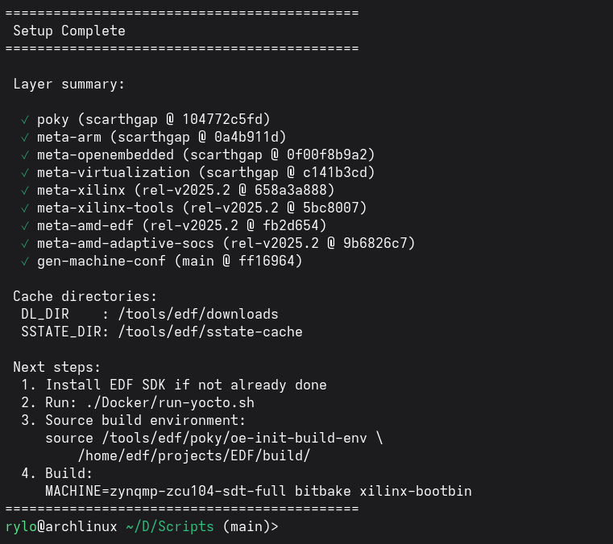
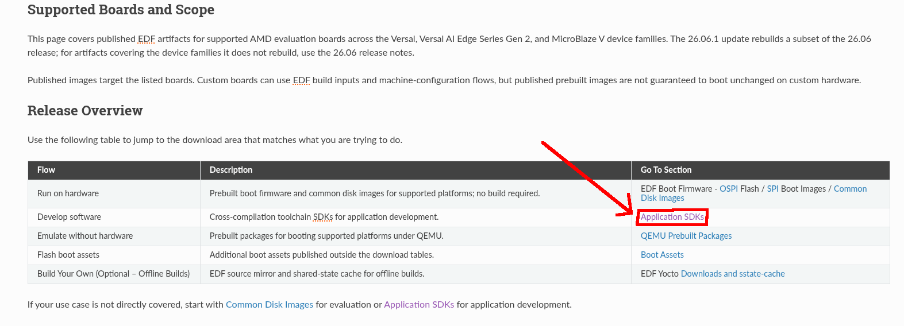
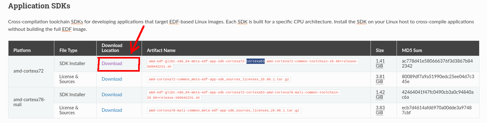
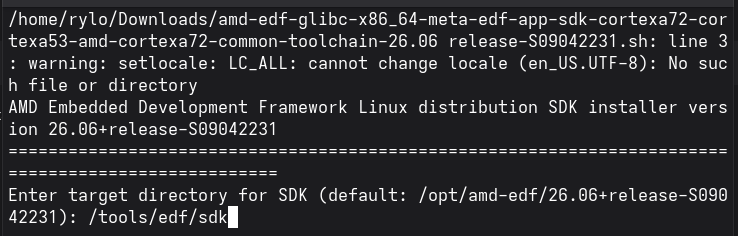

# How to setup the build system

This document will provide the steps required to build this project from a blank system

0. Preliminary requirements

The following is required to setup the build system:
 
  - Docker
  - At least 100 GB of free space
  - An AMD Account

## 1. Run the script in this directory to initialize

```
./setup_edf_tools.sh
```

You should see this when complete:



## 2. Obtain the EDF SDK installer

Visit the AMD EDF website and go to the downloads and releases section:

https://edf.docs.amd.com/en/latest/downloads-and-release-notes.html

Click on the link which takes you to the SDK downloads:


The ZCU104 has a quad-core Arm Cortex-A53 processor and so we need the SDK which supports the "cortexa53" architecture. Select the "amd-cortexa72" installer as it additionally supports 53:



Note: You will need an AMD account (free) to continue the download.
After downloading you should have a ~1.5 GB sh script.

## 3. Run the EDF SDK installer

Mark the script as executable and run it. Select the target directory to ```/tools/edf/sdk```



The setup process should be complete 

